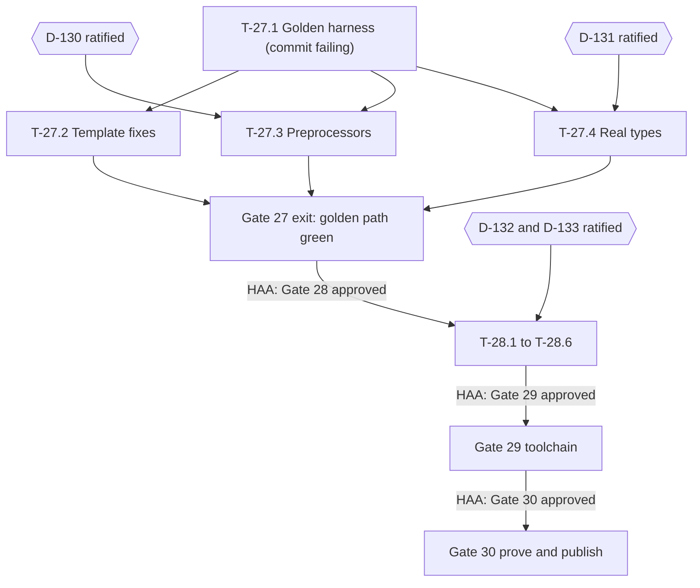

# Agent Task Directive: Production Hardening (Gates 27–30)

**Source:** `PRODUCTION_READINESS_AUDIT.md`
**Status:** AUTHORITATIVE (Gate 27 Approved by Human Architecture Authority on 2026-11-09).
**Active Assignment:** Set in `AGENT_HANDOFF.md`.

> [!IMPORTANT]
> Authorization is **per gate**. Approving this document authorizes **Gate 27 only**. Gates 28–30 each need explicit written approval ("Gate 28 is approved") per AGENTS.md §4. Tasks marked 🔒 also need their decision (D-130…D-133) ratified first.

---

## 0. Operating rules for the executing agent

These rules exist because of the specific failures found in the audit.

1. **Test first, always.** Every task starts with a test that reproduces the defect and **fails** on the current code. Commit it as a separate commit before the fix (`test(gXX): reproduce …`). A fix without a failing-first test is not accepted.
2. **Test the user path, not just the unit.** A task is only done when the **golden-path harness** (T-27.1) passes for every scaffold variant. Unit tests alone never count as proof.
3. **No silent workarounds.** If a fix needs changing a test, the showcase or a template to *avoid* a limitation (as with `fallback="text"`), **stop and report it** as a finding. Never weaken a test or assertion to make it pass.
4. **Truthful reporting.** In every completion report, list what was **not** verified. Never write "0 errors" or "fully supported" without naming the exact command and variants that were run.
5. **Stop conditions** (AGENTS.md §5). Stop and write a contradiction report if:
   - a fix needs a grammar, spec or decision change not covered by an approved D-entry;
   - a runtime package would gain a dependency;
   - a test from an earlier gate starts failing and the cause is not clearly your own regression;
   - a task's acceptance criteria can't be met as written.
6. **One task = one focused commit series.** Commit message format: `fix(gNN/T-NN.M): …`. Don't bundle unrelated changes.
7. **Verification gate before every commit:**
   ```bash
   npm run build && npm run lint && npm test && npm run test:golden
   ```
   (`test:golden` is added by T-27.1.)

---

## 1. Decisions requiring HAA ratification (blocking 🔒 tasks)

| ID | Proposal | Amends | Blocks |
| :--- | :--- | :--- | :--- |
| **D-130** | Add a **build-time preprocessor stage** before `compileCss`. `.scss`/`.sass` use `sass`, `.less` uses `less`, `.pcss`/`.postcss` use `postcss`. These are **optional exact-pinned peer dependencies of `@mix/compiler-css`/`@mix/cli` only**; `@mix/runtime` stays at zero deps. `@import`/`@use` are allowed **inside preprocessor files** and resolved at build time. The D-108 ban stays in force for raw `<style>` blocks and for the CSS that comes out of preprocessing. If a preprocessor is missing, the build **fails with an install instruction**. Source is **never** passed through unprocessed. | D-108 | T-27.3 |
| **D-131** | `typecheckTix` resolves `@mix/*` against the **real emitted `.d.ts`** of each package (via `exports`), and resolves relative user modules (`.tix`/`.mix`/`.ts`) through a real `CompilerHost`. The hand-written ambient `@mix/runtime` declaration is removed; the ambient file keeps only asset-module shims (`*.css`, `*.scss`, …). | D-106 (implementation detail) | T-27.4 |
| **D-132** | The template grammar accepts **element and fragment expressions inside `{…}` attribute values** (`fallback={<span/>}`, `icon={<Icon/>}`), parsed as a nested template subtree and compiled to a lazily-mounted render function. | Canonical grammar spec | T-28.4 |
| **D-133** | Confirm **one canonical control-flow syntax**: D-112 `{if}/{elseif}/{else}/{endif}` and `{each (x, i) in list}/{endeach}`. Legacy `{#if}`/`{#each}` keep parsing but get a **deprecation warning** from the compiler and LSP. JSX `{cond && <el/>}` is either (a) supported via D-132 or (b) diagnosed with a hint to use `{if}`. **HAA must choose (a) or (b).** | D-112 (clarification) | T-27.2 step 4, T-28.4 |

The agent may draft the full D-entry text into `governance/DECISION_REGISTER.md` as `Status: PROPOSED`. It must not mark any of them ratified.

---

## 2. Gate 27: Golden Path (P0, blocking everything else)

**Goal:** a freshly scaffolded project, in every variant, passes `check` and `build`, and its output runs.

### T-27.1: Golden-path E2E harness (no decision needed, do first)
- **Files:** `tests/golden/golden-path.test.mjs` (new), root `package.json` (script `test:golden`).
- **Steps:**
  1. For each variant in {TS, JS} × {scss, sass, less, pcss, css}, run `mix create` into a temp dir via the **real CLI binary** (`node packages/cli/dist/bin.js`), not the `create()` function.
  2. Run `mix check src` and assert exit code 0 with no `[ERROR]` lines.
  3. Run `mix build src dist` and assert exit code 0 with no stack trace on stderr.
  4. **Specifier audit:** parse every emitted `.js` file and check that each import specifier is relative, or resolves through the package `exports` map. Assert there are no `file:///` absolute paths. This statically catches the import-map class of bug.
  5. **Execution smoke:** load the built entry in `happy-dom`, mount it, and assert the root layout and home page render. Then navigate to `/tasks` and `/forms`.
  6. **CSS validity:** run every emitted `.css` back through `css-tree` in strict mode and assert there's no leftover preprocessor syntax (`&-`, `$`, `@mixin`, `@include`, Less `@var:`).
- **Expected initial state:** **FAILING.** Commit it failing (marked `todo` per variant so `npm test` stays green while `test:golden` is red) and record the exact failure list in the commit body.
- **Acceptance:** the harness runs all 10 variants and reports per-variant, per-step results.

### T-27.2: Scaffold template corrections (no decision needed, except step 4)
- **Files:** `packages/cli/src/create.ts`, `packages/cli/src/bin.ts`.
- **Steps:**
  1. Replace `RouterView` with the real `RouterProvider` API (check its props in `packages/router/src/components.ts`).
  2. Remove `--watch` from the generated `dev` script until T-29.1 exists, or point `dev` at a working command.
  3. Fix the generated code's type errors: `NavLink end` prop typing, the `TasksPage` item type, the `FormsPage` `onSubmit` param, and typed component props. Use real types, never `any`, in `.tix` templates.
  4. 🔒 (D-133) Rewrite control flow in templates to the canonical syntax.
  5. Move templates out of string literals into real files under `packages/cli/templates/{ts,js}/…`, with `{{styleExt}}`-style token substitution, so templates can themselves be linted and checked.
- **Acceptance:** T-27.1 steps 1–2 pass for the `css` variants of TS and JS (preprocessor variants depend on T-27.3, TS type-resolution on T-27.4).

### T-27.3 🔒 (D-130): Real preprocessor stage
- **Files:** `packages/compiler-css/src/preprocess.ts` (new), `packages/compiler-codegen/src/index.ts` (call site), `packages/cli`, `examples/showcase/build.mjs`, the package manifests (optional peer deps, exact pins).
- **Steps:**
  1. Failing tests: SCSS variables and nesting with `&-suffix`, `@use`/`@import` partials, Less variables and mixins, and PostCSS. Each must produce **valid, scoped CSS**.
  2. Failing test: a missing preprocessor produces diagnostic `MIX_ERR_PREPROCESSOR_MISSING` with an install hint.
  3. Failing test: plain `.css` still rejects `@import` (D-108 unchanged for raw CSS).
  4. Implement `preprocess(source, { lang, filename, loadPaths })`, then run `compileCss` on the result. Map preprocessor source maps through to the final output.
  5. Add the resolved partial paths to the build's watch and dependency list.
- **Acceptance:** the T-27.1 CSS-validity step passes for scss, sass, less and pcss in both languages.

### T-27.4 🔒 (D-131): Typecheck against real types
- **Files:** `packages/compiler-semantic/src/index.ts` (`typecheckTix`, ambient file, module resolution).
- **Steps:**
  1. Failing tests: a `.tix` file importing `createForm` and `validators` from `@mix/runtime`, `Can` from `@mix/runtime/permissions`, a sibling `.tix` component, and a `.ts` store. All must resolve with correct types, and a wrong prop must still be diagnosed.
  2. Resolve `@mix/*` via the package `exports` map to the emitted `dist/**/*.d.ts`.
  3. Resolve relative `.tix`/`.mix` imports by projecting them on demand (reuse `projectTypeScript`) and cache by content hash.
  4. Delete the hand-maintained ambient runtime declarations. Keep only the asset shims.
  5. Add a guard test that fails if any runtime export is missing from the type surface seen by `typecheckTix`.
- **Acceptance:** all TS variants pass T-27.1 step 2, and existing Gate 3/8 typecheck tests still pass.

### Gate 27 exit criteria
- `npm run test:golden` is **fully green for all 10 variants** (no `todo` left).
- The completion report includes the per-variant output table and a "not verified" list (real browsers are explicitly **not** verified until Gate 30).

---

## 3. Gate 28: Correctness and security (P1)

### T-28.1: Reactive `<Can>`
- **Files:** `packages/runtime/src/permissions/Can.ts`, and possibly compiler special-casing.
- **Steps:** failing DOM test (mount `<Can>`, flip the role signal, assert the DOM swaps between children and fallback; flip a subject signal, assert it swaps again; assert the sibling DOM node identity is preserved). Then implement on top of the same reactive conditional primitive as `{if}` (`createConditional`), with proper owner disposal of the inactive branch.
- **Acceptance:** the test passes; the showcase PermissionsPage works using `<Can>` alone, with no helper `computed`s.

### T-28.2: Router permission enforcement on initial load and ability change
- **Files:** `packages/router/src/router.ts`.
- **Steps:** failing tests for (a) creating a router at `/admin` without permission (redirects, loader not called); (b) downgrading the ability while on `/admin` (redirects); (c) popstate onto a protected route. Then run the guard pipeline during router initialization (async-aware, with the initial render held in a pending state) and subscribe to the ability signal.
- **Docs:** add a **"Client guards are not authorization"** section to the router docs.

### T-28.3: Permissions hardening
- **Files:** `packages/runtime/src/permissions/ability.ts`.
- **Steps:** failing tests, then fixes:
  - `constructor.name` subject detection emits a dev warning and is disabled when `detectSubjectType` or `strictSubjects: true` is configured;
  - object conditions unwrap **only branded signals** (add a `isSignal` brand in core), never arbitrary methods;
  - an async predicate hit by sync `can()` throws `MIX_ERR_ASYNC_RULE_IN_SYNC_CHECK`;
  - the `useAbility()` proxy is memoized per context.

### T-28.4 🔒 (D-132, D-133): Element expressions in attributes
- **Files:** `packages/compiler-frontend` (expression parser), `compiler-semantic`, `compiler-codegen`, `compiler-ssr`, `language-server`, and the canonical grammar spec in `spec/`.
- **Steps:** spec text first (as part of the D-132 ratification), then parser conformance tests (valid and invalid cases with exact spans), then codegen to a lazily-mounted render function, then SSR parity, then LSP support.
- **Revert the earlier workarounds:** restore `fallback={<span …/>}` in the showcase and scaffold.

### T-28.5: Production sanitizer
- **Steps:** add an official `@mix/sanitizer-dompurify` adapter package (DOMPurify as an exact-pinned dependency of that package only, never of runtime). Replace the regex sanitizer in the showcase and docs. Add tests with known XSS vectors (``, `<svg onload>`, `javascript:` URLs).

### T-28.6: Fix the false-confidence tests
- **Steps:** strengthen `native-permissions` test 3 to check DOM output; make `project-scaffold.test.mjs` cover TS variants with `typecheckTix` (or fold it into the golden path). Add a "tests that assert behavior, not return values" checklist to `CONTRIBUTING`.

**Gate 28 exit criteria:** all items green plus the golden path still green. All audit contradictions C2, C3, C5, C7, C8 and C9 closed, with links to their tests.

---

## 4. Gate 29: Production toolchain (P2)

| Task | Summary | Acceptance |
| :--- | :--- | :--- |
| **T-29.1** | `mix dev`: a dev server built on `@mix/vite-plugin`, with HMR, import resolution and the SPA fallback. Replaces the hand-maintained showcase import map. | Golden-path variants start `mix dev`, serve `/`, and a file edit triggers HMR (automated). |
| **T-29.2** | `mix build` goes through Vite/Rollup: bundling, code-splitting per lazy route, minification, hashed assets, and no `file:///` specifiers. | The specifier audit passes; a bundle-size report is emitted. |
| **T-29.3** | Formatted diagnostics: code frame, file:line:col, error code and docs link. The CLI never prints a raw stack trace (`--debug` restores it). | A golden test asserts the error format for a deliberately broken component. |
| **T-29.4** | SSR server adapter (`@mix/server-node`): streaming HTML, error-recovery boundaries, and CSP nonce support for `injectStylesheet`. | Integration test: an HTTP request returns streamed HTML that hydrates without mismatch in happy-dom; a CSP header with a nonce is honored. |

---

## 5. Gate 30: Prove and publish (P3)

| Task | Summary | Acceptance |
| :--- | :--- | :--- |
| **T-30.1** | Playwright matrix (Chromium, Firefox, WebKit) over the showcase and a golden-path scaffold. Needs an exact-pinned root devDependency, which is flagged for HAA review. | CI green in all 3 browsers. |
| **T-30.2** | Benchmarks: a js-framework-benchmark-style suite plus bundle-size budgets enforced in CI. **Results are published as measured, including any losses.** | Budgets enforced; results doc committed. |
| **T-30.3** | Docs site, semver/release policy, changelog, then publish `0.x` to npm. | `npm create mix@latest` works from the public registry in a clean container. |

---

## 6. Execution order and dependencies



---

## 7. Completion report template (required at the end of each gate)

```markdown
## Gate NN completion report
- Tasks closed: T-NN.x … (commit SHAs)
- Audit findings closed: Cx … (link to reproducing test)
- Verification commands run + results: build / lint / test (N/N) / test:golden (variant table)
- NOT verified: …
- Workarounds or limitations discovered: … (must be empty or escalated)
- Open contradictions / decisions needed: …
- Request: "Gate NN+1 approval"
```

