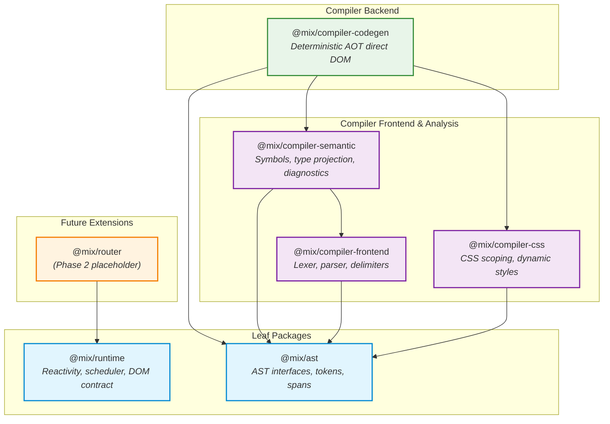

# Phase 0 Audit Report — Implementation Readiness

**Project:** Mix / Tix Framework  
**Phase:** Phase 0 (Repository Foundation and Implementation Readiness)  
**Date of Audit:** 2026-11-08  
**Author:** Antigravity (Implementation Agent)  
**Status:** Complete — Pending Human Architecture Authority Review

---

## 1. Scope Completed in Phase 0

Per `PHASE_0_SCOPE.md` and `AGENT_HANDOFF.md`, Phase 0 activities were strictly limited to repository foundation verification, toolchain proposal, dependency topology analysis, and auditing specification contracts. **No compiler or runtime code has been written.**

Completed Phase 0 items:
- [x] **P0-01 (Repository Structure):** Inspected and verified monorepo layout, package placeholders, and spec directory.
- [x] **P0-02 (Workspace Metadata):** Verified root `package.json` has `"private": true`, `"workspaces": ["packages/*"]`, and no extraneous dependencies.
- [x] **P0-03 (TypeScript Baseline):** Verified shared `tsconfig.base.json` with strict mode, `NodeNext` modules, and zero false claims of compilation.
- [x] **P0-04 (Specification Inventory):** Inspected all 12 specification documents under `spec/`.
- [x] **P0-05 (Decision Register):** Audited architectural decisions D-001 through D-008 and open decisions D-101 through D-111 in `DECISIONS.md`.
- [x] **P0-06 (Agent Handoff):** Reviewed agent boundaries, constraints, and change-control rules.
- [x] **P0-07 (Scaffold Verification):** Executed `npm test` and verified structural integrity.
- [x] **P0-08 (Agent Audit):** Produced this comprehensive audit report (`reports/phase-0-audit.md`).

---

## 2. Repository Inventory and Exact Tool Versions

### 2.1 Host Environment and Tool Versions
| Tool / Environment | Detected Version / Status | Note |
|---|---|---|
| Operating System | Windows 11 (Windows NT x64) | Local execution environment |
| Node.js | `v22.12.0` | Meets `engines.node >= 22` requirement |
| npm | `11.7.0` | Workspace-capable package manager |
| TypeScript | *Not installed* (`tsc` not found) | To be installed as pinned devDependency in Phase 1 |
| Git repository | *Not initialized* (`.git` absent) | Recommendation: Initialize git repository before Phase 1 |
| Lockfile | *None* (`package-lock.json` absent) | Will be generated upon first approved `npm install` |
| `node_modules` | *None* | Zero dependencies installed currently |

### 2.2 Packages Inventory
All packages are scoped under `@mix/` and declared in root `package.json` workspaces:

| Package Directory | Package Name | Declared Version | Purpose / Phase |
|---|---|---|---|
| `packages/ast` | `@mix/ast` | `0.1.0` | AST node interfaces, spans, token contracts (Phase 1-2) |
| `packages/compiler-frontend` | `@mix/compiler-frontend` | `0.1.0` | Lexer, template markup parser, expression boundaries (Phase 2) |
| `packages/compiler-semantic` | `@mix/compiler-semantic` | `0.1.0` | Scope analysis, type projection, diagnostic validation (Phase 2) |
| `packages/compiler-css` | `@mix/compiler-css` | `0.1.0` | Scoped CSS parsing, selector scoping, dynamic style checks (Phase 2, 4) |
| `packages/compiler-codegen` | `@mix/compiler-codegen` | `0.1.0` | Deterministic AOT code generator emitting direct DOM ops (Phase 2) |
| `packages/runtime` | `@mix/runtime` | `0.1.0` | Reactive core, scheduler, lifecycle, DOM adapter (Phase 1, 3) |
| `packages/router` | `@mix/router` | `0.1.0` | Client-side routing (*Phase 2 placeholder only*) |

### 2.3 Specification Documents Inventory
All specification files currently exist as Phase 0 placeholders and await canonical v3.2.1 import and reconciliation:

| Specification File | Current State | Targeted Scope / Reconciled Decisions |
|---|---|---|
| `spec/README.md` | Direction note | Guidance on canonical import |
| `spec/SPEC_STATUS.md` | Tracking table | Baseline v3.2.1 status tracking |
| `spec/LANGUAGE.md` | Placeholder (3 lines) | Canonical grammar, `.mix` vs `.tix`, dynamic element syntax (D-105) |
| `spec/AST.md` | Placeholder (3 lines) | AST nodes, source spans, immutable tree invariants (D-105, D-106) |
| `spec/SEMANTICS.md` | Placeholder (3 lines) | Pull-Push reactivity, reactive cycles, owner lifecycle (D-101, D-102, D-110) |
| `spec/RUNTIME_API.md` | Placeholder (3 lines) | Reactive primitives, `createRoot`, resource cancellation (D-101 to D-104) |
| `spec/CSS_SCOPING.md` | Placeholder (3 lines) | Scoped selector rules, dynamic CSS validation (D-108) |
| `spec/DIAGNOSTICS.md` | Placeholder (3 lines) | Error codes, source-map span preservation (D-106) |
| `spec/SECURITY.md` | Placeholder (3 lines) | Threat model, `srcset` parsing, trusted HTML boundary (D-107, D-109) |
| `spec/TESTING.md` | Placeholder (3 lines) | Conformance test plans, regression and security test suites |
| `spec/PERFORMANCE.md` | Placeholder (3 lines) | Benchmark methodology, memory and reconciliation targets |
| `spec/COMPATIBILITY.md` | Placeholder (3 lines) | Target ECMAScript baseline (ES2022), browser baseline |

### 2.4 Test Suite Placeholders
- `tests/conformance/.gitkeep` (Compiler language and syntax tests)
- `tests/runtime/.gitkeep` (Reactive core and lifecycle tests)
- `tests/integration/.gitkeep` (End-to-end component rendering and updates)
- `tests/security/.gitkeep` (XSS, URL, CSS injection, and sanitizer tests)

---

## 3. Current Scaffold Validation Output

Scaffold verification was executed directly via `npm test` (`node scripts/verify-phase0.mjs`).

```text
> mix-tix@0.1.0 test
> node scripts/verify-phase0.mjs

Phase 0 scaffold check passed (24 required paths).
This check validates repository structure only; it does not test compiler behavior.
```

- **Exit code:** `0`
- **Scaffold Check Analysis:**
  - Evaluates all 24 required files across the root, `spec/`, and `packages/*/package.json`.
  - Confirms root `package.json` contains `"private": true` and `"workspaces": ["packages/*"]`.
  - Confirms zero premature implementation code has been committed.

---

## 4. Proposed Minimal TypeScript Build / Test / Lint Toolchain

### 4.1 Constraints Observed
- Bootstrap language: **TypeScript** exclusively. No C#, no Python.
- Architectural rule: **No React, Babel, Webpack, or Rollup** as foundational dependencies.
- Runtime rule: **`@mix/runtime` must have zero avoidable external runtime dependencies.**
- Version rule: Pin exact versions once approved; no loose floating ranges in `package.json` / `package-lock.json`.

### 4.2 Proposed Toolchain Components

```text
+-----------------------------------------------------------------------------------+
| Monorepo Dev Toolchain (Root devDependencies only)                                |
|                                                                                   |
|  - Type checking & Build:  typescript@5.7.3 (`tsc --build`)                       |
|  - Types:                  @types/node@22.10.7                                    |
|  - Test Runner:            Node.js Native Test Runner (`node:test`, `node:assert`)|
|  - DOM Test Adapter:       happy-dom@15.11.7 (strictly tests/ devDependency)      |
|  - Linter:                 eslint@9.19.0 + typescript-eslint@8.21.0               |
+-----------------------------------------------------------------------------------+
```

#### Detailed Rationale:
1. **Compilation (`tsc --build` with Project References):**
   - Tool: `typescript@5.7.3`.
   - Reason: Standard compiler API. Using composite projects (`composite: true` in `tsconfig.json`) allows `tsc -b` to compile packages in topological order with `.d.ts` declaration generation and incremental builds. Completely eliminates the need for Webpack, Rollup, Vite, or Babel.
2. **Standard Parser / TypeScript Compiler API:**
   - Tool: Reuse `typescript` for JS/TS expression parsing (`ts.createSourceFile` or `ts.createScanner`) or a tiny standalone parser like `acorn@8.14.0` if pure JS ASTs without TS AST baggage are preferred for expressions.
   - Reason: Satisfies constraint D-007 while strictly avoiding Babel.
3. **Test Runner (Native `node:test` + `node:assert/strict`):**
   - Tool: Node.js 22 built-in test runner.
   - Reason: Node 22 (`v22.12.0` present in host) provides a full-featured, zero-dependency test runner with subtest suites, mocking (`node:test/mock`), concurrency, and native coverage (`--experimental-test-coverage`). Avoids bringing in Jest or Vitest (which depend on Vite/Rollup/esbuild).
4. **DOM Environment for Tests (`happy-dom@15.11.7`):**
   - Tool: `happy-dom` (pinned, devDependency only for integration/runtime tests).
   - Reason: Fast, lightweight DOM implementation for running runtime tests in Node without a full browser.
5. **Linting (`eslint@9.19.0` + `typescript-eslint@8.21.0`):**
   - Tool: ESLint with modern flat config (`eslint.config.mjs`).
   - Reason: Enforces type safety, strict naming, and prevents DOM leaks into platform-neutral `@mix/runtime`.

---

## 5. Package Dependency Graph (Acyclic Verification)

The monorepo dependency hierarchy is strictly acyclic (DAG). Leaf packages depend on nothing, and compiler stages maintain single-direction information flow.



### Dependency Topological Sort (Build Order):
1. Level 0: `@mix/ast`, `@mix/runtime` (independent leaf packages, parallel compile)
2. Level 1: `@mix/compiler-frontend`, `@mix/compiler-css`, `@mix/router`
3. Level 2: `@mix/compiler-semantic`
4. Level 3: `@mix/compiler-codegen`
5. Level 4: `tests/*` (consumes codegen, semantic, and runtime)

*Verification:* No backward or circular references exist. `@mix/runtime` never imports from `@mix/ast` or `@mix/compiler-*`.

---

## 6. Specification Contradictions and Missing Definitions Audit

An in-depth audit of the v3.2.1 baseline and `DECISIONS.md` reveals 11 critical contracts that must be reconciled:

| Decision ID | Area | Prior Contradiction / Missing Definition | Analysis & Agent Recommendation |
|---|---|---|---|
| **D-101** | Reactive Effects | Contradiction between strict prevention of self-writes vs deferred rerun. | **Recommendation:** Adopt **Deferred Rerun** with a strict loop threshold (e.g. 100 iterations) throwing `ReactiveCycleError`. Strict rejection breaks valid signal updates in effects that update auxiliary tracking signals. Reruns must coalesce duplicate notifications. |
| **D-102** | Lifecycle States | Conflation between Owner lifecycle (`ACTIVE \| DISPOSED`) and Computation state (`CLEAN \| CHECK \| DIRTY \| RUNNING`). | **Recommendation:** Clearly decouple: Owner state is binary (`ACTIVE \| DISPOSED`). Computation state adds explicit `DISPOSED`. Disposed computations unlink all sources/observers immediately and cannot be scheduled. |
| **D-103** | `createRoot` | Prior specification showed a bodyless function in non-ambient space. | **Recommendation:** Place canonical signature `createRoot<T>(fn: (dispose: () => void) => T): T` in `@mix/runtime`. The root owner has `null` parent, registers cleanups, and returns the factory result. |
| **D-104** | Cancellation & Resources | Unclear token ownership; browser `AbortSignal` leaked into platform-neutral core. | **Recommendation:** Define a platform-neutral `CancellationToken` in `@mix/runtime` with generation tokens. DOM renderer adapter bridges `AbortSignal` to `CancellationToken`. Owner disposal triggers cancellation. |
| **D-105** | DynamicElement Syntax | Grammar discrepancy between `<{tag}>` and `<{~tag}>`. Delimiter collision in expressions. | **Recommendation:** Standardize on `<{tag}>`. The opening tag evaluates once; the closing tag reuses the resolved element constructor. Delimiter scanner must handle nested braces, template strings, and comments. |
| **D-106** | Type Projection & Spans | `VerifyRef` / `VerifyProps` sketches referenced undefined types; span mapping was lossy. | **Recommendation:** Standardize component model on `ComponentFactory<Props>`. Implement bidirectional span mapping so generated diagnostic spans map directly to original template locations. |
| **D-107** | `srcset` Parsing | Claimed "WHATWG compliant" without a normative algorithm or handling edge cases (commas in data URLs). | **Recommendation:** Specify a deterministic micro-algorithm in `spec/SECURITY.md` covering candidate splitting, descriptor parsing (`w`/`x`), and data URL handling, backed by explicit test vectors. |
| **D-108** | Dynamic CSS Validation | Missing runtime validation path for dynamic expressions; `@import` improperly treated. | **Recommendation:** Compile-time rejects `@import` and invalid selectors. Runtime style bindings enforce property-name allowlisting and CSS value escape decoding to prevent CSS injection. |
| **D-109** | Trusted HTML Boundary | Branded TypeScript types (`type TrustedHTML = string & ...`) vanish at runtime and offer no security. | **Recommendation:** Specify an explicit runtime sanitizer contract (`SanitizerProvider` interface). Unsanitized raw HTML strings throw runtime security errors unless processed by an approved sanitizer. |
| **D-110** | Keyed Reconciliation | Missing duplicate key policy and intermediate reactive leak guarantees. | **Recommendation:** First key wins; subsequent duplicates emit diagnostic warning and are assigned fallback surrogate keys. All list item updates batch before DOM mutations are committed. |
| **D-111** | HMR Method Dispatch | `Function.bind()` fails to update closed-over variables upon reload. | **Recommendation:** Codegen emits methods that receive a stable context proxy (`ctx`), allowing HMR to hot-swap method logic while referencing live component state. |

---

## 7. Exact Decisions Requiring Human Architecture Authority Approval

Before Phase 1 implementation can begin, the human architecture authority must explicitly review and decide on the following 5 core items:

1. **Toolchain Approval:**
   - Confirm TypeScript 5.7.3 + `tsc --build` composite projects.
   - Confirm Node 22 native test runner (`node:test`) + `happy-dom` for dev/test execution.
   - Confirm ESLint 9 flat configuration.
2. **Reactive Effect Policy (D-101):**
   - *Option A:* Deferred rerun with cycle-detection threshold (Max 100 runs, recommended).
   - *Option B:* Strict immediate throw on any self-mutating effect write.
3. **Canonical Syntax for Dynamic Elements (D-105):**
   - *Option A:* `<{expr}> ... </{expr}>` (Recommended for clarity).
   - *Option B:* `<{~expr}> ... </{~expr}>`.
4. **HTML Security Boundary Model (D-109):**
   - Confirm requiring a pluggable runtime `SanitizerProvider` (e.g. DOMPurify adapter) rather than relying on compile-time TypeScript type branding.
5. **Phase 1 Implementation Scope Gate:**
   - Approve the Phase 1 Task Breakdown and the minimal vertical slice definition.

---

## 8. Phase 1 Task Breakdown with Acceptance Criteria

Upon human authorization of this report and the decisions above, Phase 1 will execute according to the following work packages:

### Work Package 1: Canonical Specification Import & Reconciliation
- **Task 1.1:** Import canonical text into `spec/LANGUAGE.md`, `spec/AST.md`, `spec/SEMANTICS.md`, `spec/RUNTIME_API.md`, `spec/CSS_SCOPING.md`, `spec/SECURITY.md`, `spec/DIAGNOSTICS.md`, `spec/TESTING.md`, `spec/PERFORMANCE.md`, `spec/COMPATIBILITY.md`.
- **Task 1.2:** Update specification text to reflect approved resolutions for D-101 through D-111.
- **Acceptance Criteria:** No file in `spec/` remains a placeholder; all 11 decision items in `DECISIONS.md` have explicit, normative algorithms and acceptance tests documented.

### Work Package 2: Toolchain & Workspace Configuration
- **Task 2.1:** Initialize Git repository and commit baseline.
- **Task 2.2:** Add root `devDependencies` (`typescript@5.7.3`, `@types/node@22.10.7`, `eslint@9.19.0`, `typescript-eslint@8.21.0`, `happy-dom@15.11.7`).
- **Task 2.3:** Create per-package `tsconfig.json` files extending `tsconfig.base.json` with composite project references.
- **Task 2.4:** Configure package manifests (`packages/*/package.json`) with `"exports"`, `"types"`, and cross-package workspace dependencies.
- **Task 2.5:** Add root scripts: `"build": "tsc -b"`, `"lint": "eslint ."`, `"test": "node --test"`.
- **Acceptance Criteria:** `npm run build`, `npm run lint`, and `npm test` execute cleanly across the workspace.

### Work Package 3: Minimal Vertical Slice Foundation
- **Task 3.1:** Define AST node contracts in `@mix/ast` required for a minimal static component (`MixElement`, `MixText`, `SourceSpan`).
- **Task 3.2:** Define core reactive primitives contract (`signal`, `effect`, `createRoot`, `Owner`) in `@mix/runtime`.
- **Task 3.3:** Define conformance test harness in `tests/conformance/`.
- **Task 3.4:** Implement Phase 1 vertical slice: A single component with one reactive signal and one text interpolation, verified end-to-end.
- **Acceptance Criteria:** Minimal vertical slice compiles to direct DOM operations and passes conformance test with verified reactivity and teardown.

---

## 9. Conclusion and Next Action

Phase 0 has verified that the repository foundation is sound, strict constraints are respected, and all architectural gaps have been cataloged with actionable recommendations.

**Agent Action:** Execution is now stopped at the Phase 0 Exit Gate. No compiler or runtime implementation will be started until the human architecture authority provides explicit approval of this audit report and the open decisions.

